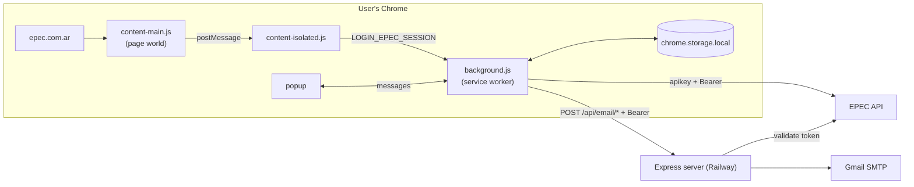
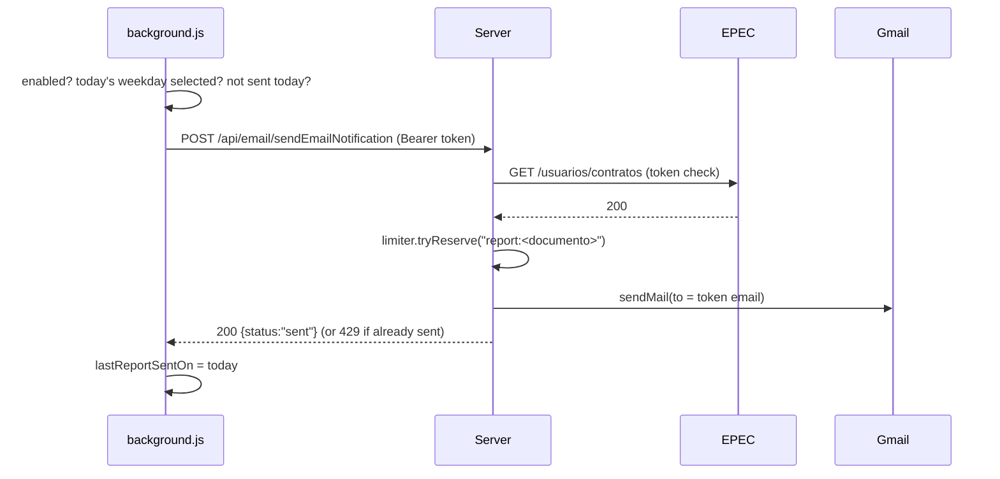

# Architecture

## Overview

EPEC Consumos Hub lets an EPEC customer see daily smart-meter consumption (kWh) in a Chrome popup and receive a daily email report. It is built so that **the server stores no customer data**: the extension holds the session and decides when a report is due; the server only verifies the caller with EPEC and sends the email.



## Components

### Chrome extension (`epec-consumption-reporting-extension/`)

Plain JS ES modules bundled by Vite into `dist/`, which is what Chrome loads (see "Decisions"). `npm run build` targets Railway; `npm run build:dev` targets `http://localhost:3000` and keeps it in `host_permissions`. From the repo root the same builds are `npm run ext:build` and `npm run ext:build:dev`, and `npm run dev` builds the dev extension and starts the local server.

| File | Responsibility |
|---|---|
| `src/content-main.js` | Runs in the page's JS world. Patches `fetch` and `XMLHttpRequest.prototype` to read the site's own `/api/login` response and posts it to the page origin. |
| `src/content-isolated.js` | Accepts that message only from the same window/origin and forwards it to the background. Also replays a session persisted in the site's `localStorage.epecUserData`. |
| `src/background.js` | Message router (`messageHandlers`), session login, data refresh, update badge, `onStartup` trigger. |
| `src/services/epecAPIservice.js` | EPEC client (`epecFetch` helper, contracts, current period, daily consumption normalised and sorted newest first). |
| `src/services/dailyReportService.js` | Decides whether today's report is due and asks the server to send it. |
| `src/services/alertService.js` | Evaluates the rolling-average threshold and asks the server for an alert. |
| `src/services/emailApi.js` | Shared email POST: 15 s timeout, classifies the answer into an outcome. |
| `src/utils/maskEmail.js`, `src/utils/emailStatusText.js` | Masked recipient (`fa•••@domain`) and the popup's Spanish email-status lines. |
| `src/storage/*` | Storage keys and getters (`getEpecUser`, `getBearerToken`, `getContractId`). |
| `src/utils/consumptionMetrics.js` | `toKwh()` (numbers or `"12,4"` strings) and `summarizeConsumption()` (total, average, 28-day projection), shared by the popup and the email report. |
| `src/popup.*` | Reports tab (total, daily average, 28-day projection, daily list) and Notifications tab (weekday picker; alert threshold UI is hidden). |

Storage keys: `epecUser`, `consumptionData`, `lastUpdated`, `notificationPrefs`, `lastReportSentOn`, `lastAlertSentOn`, `sessionExpired`, `selectedContractId`, `lastEmailStatus` (`{ report, alert }`, the latest outcome of each email, shown in the popup).

### Server (`epec-consumos-webhooks-server/`)

Stateless Express 5 + TypeScript, run with `tsx`.

```
routes/emailRoutes.ts               POST /api/email/sendEmailNotification | /sendEmailAlert
routes/healthRoutes.ts              GET /api/health (no auth, no limit)
middleware/requireEpecToken.ts      Bearer token → EPEC must accept it → res.locals.epecUser {email, documento}
middleware/limitOneEmailPerDay.ts   one email per kind per user per Córdoba day (429 otherwise)
controllers/emailController.ts      validates {subject, htmlContent}, sends to the token's email
services/emailService.ts            nodemailer Gmail transport, sendEmail() throws on failure
services/epecAPIservice.ts          getContratos(), used as the token check
services/dailyRateLimiter.ts        in-memory limiter
config.ts                           getPort(): PORT from env, 3000 fallback
listenResult.ts                     logs 'running', or logs the listen error (EACCES/EADDRINUSE) and exits 1
maskEmail.ts                        fa•••@domain for the 'Email sent to …' log line
```

## API

### Server

`GET /api/health` → `200 { "status": "ok" }`. No auth and no rate limit; it only shows the process is up.

`POST /api/email/sendEmailNotification` and `POST /api/email/sendEmailAlert`

```http
Authorization: Bearer <EPEC JWT>
Content-Type: application/json

{ "subject": "…", "htmlContent": "<p>…</p>" }   // htmlContent ≤ 100 000 chars
```

| Status | Meaning |
|---|---|
| 200 | `{ "status": "sent" }`: sent to the email inside the verified token |
| 400 | Missing/invalid subject or htmlContent, or token has no email/documento |
| 401 | Missing Bearer header, or EPEC rejected the token |
| 429 | This user already received this kind of email today |
| 502 | Gmail rejected the message (the daily slot is released) |
| 503 | EPEC unreachable while validating the token |

### EPEC (upstream)

All calls send `apikey` (`web-prod`, EPEC's public web key) and `Authorization: Bearer <jwt>`. The JWT payload carries `email`, `documento` (DNI) and `sub`.

| Endpoint | Use |
|---|---|
| `POST /api/login` | Not called by us; intercepted from the site |
| `GET /usuarios/contratos` | Contracts (`id`, `nroCliente`, `razonSocial`, `direccion`); only `[0]` is used. Server uses it as the token check. |
| `GET /usuarios/contratos/{id}/consumos/tipo-medicion` | Current billing period (`desde`, `hasta`, meter info) |
| `GET /usuarios/contratos/{id}/consumos/con-telemedicion/MED_INTELIGENTE/CONSUMO_DIARIO?desde&hasta` | Daily readings `{fechaHora: "dd/mm/yyyy", consumo: "12,4"}`; `hasta` is `DDMMYYYYHHmm`, Córdoba time |

## Key flows

**Login capture.** The user logs in on epec.com.ar → `content-main.js` sees the `/api/login` response → `content-isolated.js` forwards it → `background.js` fetches contracts, stores `epecUser`, refreshes data.

**Data refresh** (`refreshData` from the popup, after login, on Chrome start). Current period → daily readings → set the `!` badge if the newest reading changed → store `consumptionData` → `sendDailyReportIfDue()` and `sendThresholdAlertIfDue()`. Both outcomes are stored as `lastEmailStatus` and returned as `emailStatus` in the `refreshData`, login and `selectContract` answers; one email failing never stops the other or the refresh.

**Daily report (on demand).**



**Email outcomes.** Each sender returns `{ kind, result, reason, at, status?, server?, recipient?, details? }` instead of throwing, so the popup can say what happened:

| result | reason | Day recorded? |
|---|---|---|
| `sent` | 200 with body `{ status: "sent" }` | yes |
| `already-sent` | 429 from the server, or `already-sent-locally` (day key already today, no call) | yes / already |
| `failed` | `server-unreachable` (fetch threw), `timeout` (15 s abort), `session-rejected` (401/403), `invalid-data` (400, server message in `details`), `server-error` (other status), `unexpected-response` (200 without `{status:"sent"}`), `unexpected-error` (bug or storage error) | no, retried on the next refresh |
| `skipped` | `disabled`, `not-today`, `no-data`, `session-expired`; alerts also `invalid-threshold`, `below-threshold` (average/limit/window in `details`) | no |

`recipient` is the EPEC user's email masked as `fa•••@domain` (the server sends to the same address, taken from the token). Logs carry only kind, result, reason and status.

**Server start.** Express 5 reports listen failures to the `app.listen` callback; `handleListenResult` logs the port and code (EACCES: port reserved or not permitted, EADDRINUSE: port already in use) and exits 1, and only logs "running" on success.

## Security model

- The server URL ships inside the extension, so it is public. Every email route therefore requires an EPEC token that **EPEC itself** accepts; we cannot verify EPEC's JWT signature locally, so the upstream call is the proof.
- The recipient is always the token's email. A caller can only email themselves, which removes the open-relay risk of the earlier version.
- The daily limiter caps each user at one report and one alert per day.
- `content-isolated.js` ignores messages not posted by the page itself, so frames cannot plant fake sessions.
- Gmail credentials (`SMTP_APP_PASSWORD`) only exist as a Railway env var.

## Rate limiting: scalability

**Question:** will the in-memory limiter have problems after running for a long time, or with many users?

**Memory:** one entry is `kind:documento` in a `Set`, roughly 100 bytes including overhead. Entries from previous days are cleared on the first request of a new Córdoba day, so memory is bounded by users seen today: ~10 MB at 100 000 daily users. It does not grow over time.

**Correctness:** Node runs this code on one thread and `tryReserve` checks and marks with no `await` in between, so concurrent requests from one user cannot both pass. Failed sends release the slot.

**Limits:**
1. State is lost on restart or redeploy, so a user could receive a second report that day. Acceptable for daily reports.
2. State is per process. With N Railway replicas a user could receive up to N emails per day.

**Conclusion:** keep it in memory while the server runs as a single Railway instance. Before scaling to more than one replica, move the limiter to a shared store (Redis on Railway or Upstash with `SET key 1 NX EX <seconds to midnight>`, or a Postgres table holding only a hash of the documento plus the date). Neither option stores personal data.

## Decisions

| Decision | Why |
|---|---|
| **No server-side user data** (Postgres removed) | The earlier design stored encrypted EPEC tokens, emails and contracts for a server cron. Sending on demand from the user's browser avoids holding sensitive data and removes stale-token, cleanup and encryption-key problems. Cost: a report only goes out on days the user opens Chrome. |
| **Extension source stays plain JS, built with Vite** | `build/build.js` runs Vite without extension plugins: background + popup as ES modules, each content script as a self-contained IIFE (MV3 content scripts cannot be modules). The API URL is a build-time `define` and `dist/manifest.json` is generated per mode, so production carries no `localhost`. Migrating to TypeScript is a separate decision; `tsconfig.json` only provides editor types (`allowJs`, `noEmit`). |
| **EPEC called directly from the extension** | The extension already holds the user's token; proxying through the server added latency and a dependency on server uptime. The `web-prod` key is EPEC's public web key. |
| **Token check via `GET /usuarios/contratos`** | Cheapest authenticated EPEC call; EPEC does not publish a key to verify its JWTs. |

## Testing

Both projects use Vitest: 53 server tests and 108 extension tests. `npm test` at the repo root runs both suites in sequence (always both, exit code 1 if either fails), or run `npm run test:run` inside one folder.

- **Server** tests sit next to the code (`src/**/*.test.ts`). `src/testing/fakeExpress.ts` provides request/response fakes, and nodemailer and the EPEC client are replaced with `vi.mock`, so no network or SMTP is needed.
- **Extension** tests live in `tests/` and run in Node rather than a browser. Small fakes stand in for what Chrome and the page provide: `chromeMock.js` (storage with both promise and callback styles, `onMessage`, `onStartup`, badge), `epecApiMock.js` (`fetch` routed to canned EPEC responses) and `pageMock.js` (the page `window` and a fake `XMLHttpRequest` whose events tests fire by hand). Content scripts and `background.js` are imported fresh per test with `vi.resetModules()`, because they register listeners at load time.
- **Time-dependent code** (Córdoba dates, weekdays, the daily limiter) is tested with fake timers at boundaries such as Córdoba midnight versus UTC midnight and New Year's Eve.
- **Practice:** every fix commit on this branch contains its own tests, and each commit passes on its own. The badge tests were confirmed to fail against the pre-fix code.

## Known limitations and follow-ups

- **Expired EPEC token:** reports fail with 401 until the user visits epec.com.ar again. The popup shows it and the extension retries on the next refresh.
- **Alerts:** `/sendEmailAlert` exists, but the extension does not compute threshold alerts yet (the alert UI is hidden in the popup).
- **One contract per user:** only `contratos[0]` is used.
- **Old database:** the Railway Postgres from the previous design may still hold encrypted tokens and emails of users who opted in. Purge it or drop the database. This is a manual step outside the code.
- **Rate limiter:** single instance only (see above).

## Review history (branch `refactor-project-restructuring`)

The restructuring commit (`7fa455f`) moved EPEC calls into the extension and reduced the server to an email relay, but left it non-functional. A review found the issues below. All were fixed in follow-up commits on the same branch, and each fix commit includes the tests for that fix.

| Finding | Fix |
|---|---|
| Service worker failed to parse (duplicate `getContractCurrentPeriod`) | `fix(extension): load service worker and fetch data from EPEC directly` |
| Extension imported `.ts` files Chrome cannot run | `refactor(extension): convert imported TS modules to plain JS` |
| `default_popup` pointed at the old path | `fix(extension): point default_popup at src/popup.html` |
| `fetchData` called deleted `/api/epec/*` routes; raw `Response` read as JSON | `fix(extension): load service worker …` |
| Email routes read empty `req.params`, swallowed errors, alert route hung, token passed as `undefined` | `fix(server): make the email endpoints actually send` |
| Email routes were an open relay (any recipient, no auth) | `feat(server): require a valid EPEC token to send email` |
| No abuse limit | `feat(server): limit each user to one email of each kind per day` |
| Hardcoded port 3000 on Railway | `fix(server): listen on process.env.PORT` |
| Patched `fetch` returned `undefined` for every non-login call on epec.com.ar | `fix(extension): return the response for every intercepted fetch` |
| `XMLHttpRequest` constructor replacement broke statics/`instanceof` | `fix(extension): patch XMLHttpRequest.prototype instead of replacing it` |
| Forged `postMessage` login accepted from any frame | `fix(extension): accept login messages only from the page itself` |
| Badge compared the oldest reading | `fix(extension): compare the newest reading for the update badge` |
| Popup crashed on numeric readings | `fix(extension): render numeric readings in the popup` |
| Weekday encoded three different ways | Unified on `"0".."6"`, Sunday = 0, in `feat(extension): send the daily email report on demand` |
| Dead code, duplicate listeners, double `sendResponse`, unused deps/files, vitest pattern typo | `refactor`/`chore` commits of the same series |
